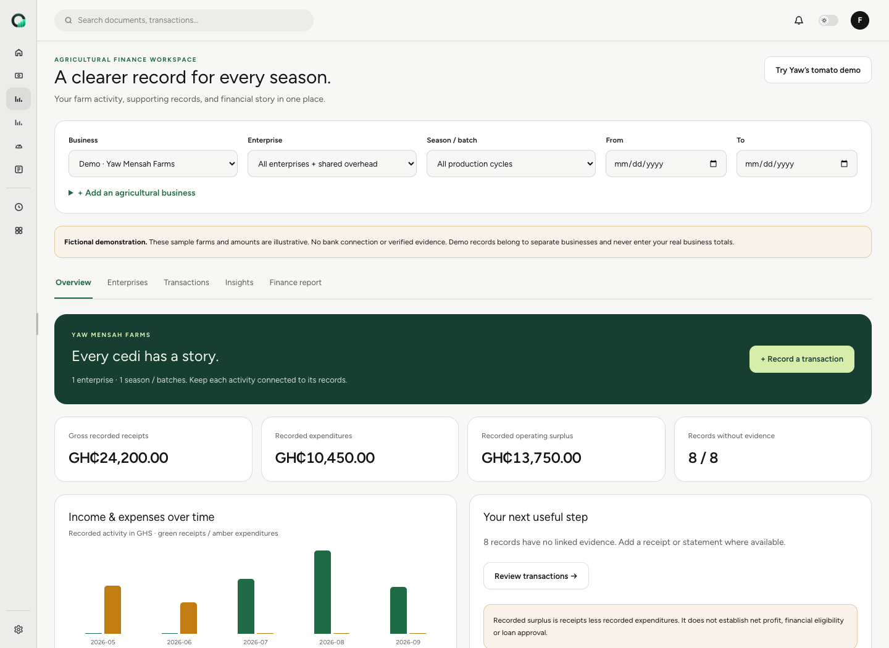
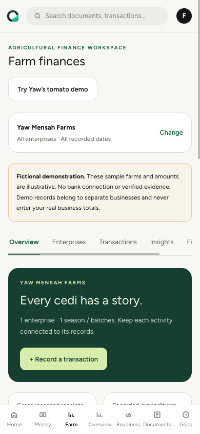

# Agricultural finance workspace — team review

This branch extends the existing OnRecord application with a farm finance
workspace. Review the changes here before making a deployment decision.

## Upstream integration status

The branch has been merged with GitHub `develop` at `311dba9` and conflicts are
resolved; everything already on `develop`, including the Google Sheets import,
is kept. See the integration section of
[`AGRICULTURE_VALIDATION.md`](../../AGRICULTURE_VALIDATION.md) for the
conflicts, the migration re-parenting, the account-deletion change and the
combined test results.

## Start here

1. Inspect the [desktop overview](./overview-desktop.png),
   [mobile overview](./overview-mobile.png), and
   [fictional sample report](./sample-report-after-edit.pdf).
2. Read the [integration guide](../../AGRICULTURE.md) and
   [executed checks and limits](../../AGRICULTURE_VALIDATION.md).
3. Review the pull request's **Files changed** and commits.
4. Capture findings in [TEAM_FEEDBACK.md](./TEAM_FEEDBACK.md) or leave PR comments.

The application source, migrations, fixtures and tests are all on this branch
of the existing OnRecord repository. The original implementation checkpoint is
`d2ed79c`; this review folder adds supporting materials without changing behavior.

## What changed

- Agricultural businesses, multiple enterprises, production seasons/batches,
  and GHS income/expense records within the existing authenticated shell.
- Crop, poultry/livestock and aquaculture categories and metadata, including
  mixed farms and explicit unallocated shared overhead.
- Entry editing/deletion with audit history, document links, and allocations
  of existing source transactions without duplicating their amounts.
- One deterministic calculation service for financial summaries, rules-based
  insights and printable lender-discussion reports.
- Explicit business access grants, awaited authorization checks, task scoping,
  upload-integrity checks and user-scoped discovery caches.
- Five fictional demo profiles, enabled only in development/test environments.

The existing Next.js/FastAPI stack, Better Auth, extracted ledger, provenance,
worker, storage architecture and readiness calculations remain the foundation.
Manual farm declarations do not feed the existing readiness indicators.

## Questions for the team

| Topic | Current implementation | Review question |
| --- | --- | --- |
| Farmer workflow | Business → enterprise → cycle → transaction → insight → report | Is the journey clear on a phone? |
| Financial language | Gross recorded receipts, expenditures and operating surplus | Are the scope and omissions clear enough for a financing discussion? |
| Evidence | A real attachment never independently verifies a manual entry | Do the badges and report disclosures communicate this clearly? |
| Mixed farming | Shared overhead stays unallocated and contributes once to business totals | Is an allocation workflow necessary for the first release? |
| Source matching | Owners explicitly match records to existing transactions; duplicate source allocation is rejected | Is the matching process understandable? |
| Permissions | Owner/reviewer grants; platform admins retain administrative authority | Who should receive each role and manage assignments? |
| Migration | Owner grants are backfilled only from owner creation audits | Which legacy associations require manual ownership validation? |
| Report distribution | Print/Save PDF and CSV; no lender portal or expiring share links | Is this sufficient for Demo Day and the initial use case? |

## Sample figures

The authoritative [Yaw fixture](../../apps/api/app/fixtures/farmers.json) starts
with GHS 24,200.00 receipts, GHS 10,450.00 expenditures and GHS 13,750.00
recorded surplus. The desktop screenshot shows this initial state.

The browser check then added a GHS 0.29 expense and edited it to GHS 0.49.
The sample PDF therefore shows GHS 10,450.49 expenditures and GHS 13,749.51
surplus. The difference is intentional and demonstrates persisted edits flowing
through to reporting. All names, farms and amounts are fictional.

## Verification and remaining work

On the combined version: 162 backend tests passed, the migration preservation
test passed on its own empty database, two money tests, TypeScript and the
Webpack production build passed. The remaining backend failure
(`test_fn_data_upload`) and all remaining ESLint errors also occur on unmodified
`develop`. The Chromium smoke test (signup through `/setup`, all five farm
profiles, transaction edit, report totals, PDF and a 390px viewport) passed on
the combined version; the screenshots and sample PDF below are from that run.

Live S3/MinIO, new OCR extraction, real OAuth-provider delivery, simulated-3G
performance and deployment were not exercised. Legacy specifications reference
golden/agent-red-team fixtures that are absent from this checkout.

Before rollout, resolve review findings, validate legacy ownership associations,
exercise the configured storage/worker/provider integration, and make a separate
deployment decision.

## Screenshots

### Desktop

### Mobile

